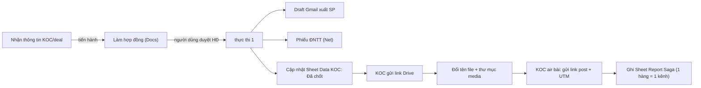

#                       GUIDELINE VẬN HÀNH (V5.0): WORKFLOW BOOKING KOC SAGA

*(AI Agent trung tâm: Antigravity + Google Docs / Sheets / Drive / Gmail APIs + cấu hình tập trung)*

---

## 1. NGUYÊN TẮC VẬN HÀNH TƯƠNG TÁC (THEO RULES.MD)




| Lệnh / sự kiện                                   | Hành động                                                 |
| ------------------------------------------------ | --------------------------------------------------------- |
| **"tôi là \[Tên\]"**                             | Đặt người phụ trách hiện tại (xem 1.3)                    |
| **"tiến hành"** (hoặc gửi mẫu thông tin KOC mới) | Làm hợp đồng (mục 2)                                      |
| **"thực thi 1"**                                 | Draft mail + Phiếu ĐNTT + cập nhật Sheet Data KOC (mục 3) |
| Gửi **link Drive** thành phẩm                    | Quy trình Media Materials (mục 4.1)                       |
| Gửi **link bài đăng + tên KOC + Link UTM**       | Ghi Sheet Report (mục 4.2)                                |


---

## 1. NGUYÊN TẮC CHUNG

### 1. Phân Tách Hợp Đồng Thông Minh:

- **Tách riêng Cast &amp; Sản phẩm**: Nếu 1 KOC vừa có Cast vừa được tặng sản phẩm $\rightarrow$ Tách tối thiểu thành:
  - 01 Hợp đồng Thương mại (Trả cast).
  - 01 hoặc nhiều Hợp đồng Trao đổi tặng sản phẩm.
- **Giới hạn 20 Triệu / Hợp Đồng Tặng SP**: Nếu tổng giá trị sản phẩm $> 20.000.000$ VNĐ $\rightarrow$ Tự động phân bổ vào các Hợp đồng tặng sản phẩm sao cho **mỗi hợp đồng** $\le 20.000.000$ **VNĐ**.
- **Quản lý Thư mục & Định danh**:
  - Dùng lại thư mục Tháng có sẵn (`Tháng MM`), không tạo trùng lặp.
  - KOC có $\ge 2$ HĐ: Tạo 1 thư mục riêng cho KOC bên trong thư mục Tháng:  
  `YYYY-MM-DD - [Tên KOC] - [Booking KOC/KOL] Hợp đồng tổng hợp - Đồng Hồ Hải Triều`
  - Nếu KOC có nhiều hợp đồng, các hợp đồng sẽ được giãn cách ngày ký khác nhau ($\pm 3$ ngày so với ngày yêu cầu tạo HĐ). Do tiền tố ngày `YYYY-MM-DD` đã khác nhau nên tiêu đề hợp đồng **không cần đánh số thứ tự (1), (2)...** và **tuyệt đối không chứa mã sản phẩm**. Tất cả các hợp đồng đều được lưu trong thư mục tổng của KOC.
  - KOC chỉ có 1 HĐ: Lưu file Doc lẻ trực tiếp trong thư mục Tháng, không tạo thư mục tổng hợp.
  - **Chỉ tạo file Google Doc** và gửi link duyệt, không xuất PDF.

### 2. Quy Chuẩn SOW (Hạng Mục Hợp Tác) - Tuyệt Đối Bám Sát Yêu Cầu:

- **KHÔNG sử dụng mẫu SOW có sẵn làm phát sinh dư hạng mục** (ví dụ SOW chỉ có 01 video TikTok, Reup Reels Story FB thì KHÔNG tự ý giữ lại 01 bộ ảnh hay video thứ hai từ mẫu cũ).
- **Cấu trúc câu chuẩn xác tại Điều 1.3 (Thời gian đăng tải)**:
  $$
  \text{Đăng 01 hạng mục -bộ ảnh/video- -nền tảng chính- (Reup -thể loại Reels/Story- -nền tảng phụ- ) (thời lượng) “rút gọn 1 câu khái quát từ định hướng kịch bản” vào ngày air}
  $$
  *Ví dụ chuẩn*:
  - `Đăng 01 Video Tiktok (Reup Reels, Story Instagram) (60-90s) “Trend Loan Niệm” vào ngày 27/10/2026`
  - `Đăng 01 photo post Instagram (Reup Threads, Tiktok - trend Loan Niệm) (6-8 ảnh) concept 20/10 vào ngày 27/10/2026 - 15/10/2026`
  - `Đăng 01 Video Tiktok (Reup Reels, Story Facebook) (60-90s) “Một dấu mốc tự thưởng cho sự kiên trì của bản thân, bé cùng bạn unbox và cảm nhận của bé khi mẹ đeo phụ kiện mới” vào ngày 11/10/2026`
- **Bảng Điều 1 (Nội dung hợp đồng)**: Bảng STT, Hạng mục, Kênh, Số lượng hình ảnh/video, Số link đính kèm, Thời gian đăng tải phải khớp 100% với SOW thực tế. Bỏ các dòng dư thừa.

### 3. Quy Chuẩn Thời Gian Hiển Thị &amp; SDHA:

- **Thời gian hiển thị bài đăng (Điều 1.4)**: **LUÔN LÀ TRỌN ĐỜI** (`Trọn đời`).
- **Thời hạn sử dụng hình ảnh SDHA (Điều 1.7)**:
  - Tùy thuộc vào SOW cụ thể (ví dụ 1 tháng, 3 tháng, 6 tháng, trọn đời...).
  - Nếu trong SOW có nhắc đến SDHA nhưng **không đề cập thời gian cụ thể** $\rightarrow$ Mặc định là **`Trọn đời`**.

### 4. Quy Chuẩn Chi Tiết Sản Phẩm Trong Hợp Đồng:

Khi có tên/mã sản phẩm, thông tin chi tiết trong bảng sản phẩm phải được bóc tách và điền đầy đủ chuẩn hóa:
*Ví dụ*: Sản phẩm `Saga Stella 55757-hggvh-2`

- **Thương hiệu**: Saga
- **Số hiệu sản phẩm**: 55757-hggvh-2
- **Bộ sưu tập**: Saga Stella
- **Xuất xứ**: Mỹ
- **Máy**: Quartz (Pin)
- **Bảo Hành Quốc Tế**: 2 Năm

### 5. Quy Chuẩn Hợp Đồng Có Cast $\ge$ 5.000.000 VNĐ:

- Trong bảng chi phí (Điều 2.1 của HĐ Cast), bắt buộc phải có đầy đủ các dòng:
  1. Phí dịch vụ booking KOC (hoặc Tổng chi phí thỏa thuận).
  2. **Thuế TNCN khấu trừ 10%** (tính theo công thức đã chốt):
     - *Nếu deal là Gross*: Thuế = Deal $\times$ 10%; Thực nhận = Deal $-$ Thuế.
     - *Nếu deal là Net*: Tổng chi phí = Deal / 0.9; Thuế = Tổng chi phí $-$ Deal; Thực nhận = Deal.
  3. **Số tiền thực nhận** mà KOC được chuyển khoản.
- Điều 2.3 (Các đợt thanh toán): Thể hiện rõ các đợt thanh toán tương ứng với giá trị thực nhận.

### 6. Quy Chuẩn Phần Người Ký Cuối Hợp Đồng &amp; Thông Tin Pháp Lý:

- **Tên người ký Bên B ở cuối hợp đồng**: Phải **đồng bộ 100% với Tên Bên B** (ví dụ BÊN B: PHẠM THU PHƯƠNG THẢO VI $\rightarrow$ Dưới bảng chữ ký Bên B phải là PHẠM THU PHƯƠNG THẢO VI, không để sót tên người mẫu cũ như PHAN NGỌC VÂN ANH hay NGUYỄN PHƯƠNG DUNG).
- **Ngày tháng ký**: Đổi chuẩn xác:  
`Hôm nay, ngày [DD] tháng [MM] năm [YYYY], tại TP. Hồ Chí Minh, chúng tôi gồm có:`
- **Loại bỏ lặp kênh**: Xóa bỏ triệt để việc lặp 2 lần dòng *"Là đại diện của kênh Tiktok"*. Mỗi kênh mạng xã hội (TikTok, Facebook, Instagram, Threads) chỉ hiển thị 1 dòng đại diện nếu KOC có kênh đó.

---

## 3. QUY TRÌNH XỬ LÝ LỆNH "THỰC THI 1" (KHI BẠN NHẮN "THỰC THI 1")

### 1. Bóc Tách Dữ Liệu Từ Hợp Đồng Ở Trạng Thái Mới Nhất:

- **KHÔNG DÙNG CACHE CŨ**: Hệ thống quét trực tiếp link Google Docs của các hợp đồng ở trạng thái mới nhất ngay khi nhận lệnh "thực thi 1" để lấy thông tin KOC, sản phẩm, showroom nhận, ngày nhận dự kiến, và phương thức thanh toán. Mọi chỉnh sửa thủ công của bạn trên Docs đều được hệ thống nhận diện tức thì.

### 2. Soạn Thảo &amp; Tự Động Đẩy Draft Vào Hộp Thư Gmail:

- **Tiêu đề email chuẩn**: `Marketing - Xuất sản phẩm tặng KOC <tên KOC>`
- **Cơ sở tra cứu thông tin showroom**: Tra cứu trực tiếp từ Sheet [Danh sách mail cửa hàng và người phụ trách](https://docs.google.com/spreadsheets/d/1G-S4EQ-HQHPMqdKk9V26yRVNQ_ZWn-dXezcZNogh-jY/edit?gid=0#gid=0) theo địa chỉ hoặc tên showroom nhận/chuyển.
- **Định dạng**: font **serif** (Times New Roman), cỡ chữ **Lớn** (Large), **in đậm** các thông tin quan trọng (lời chào, tên KOC, sản phẩm xuất, showroom, ngày cần nhận/ngày lấy, SĐT, CCCD, "Lưu ý", thao tác xuất giá 0 đồng).
- **Người nhận**: **KHÔNG đề xuất người nhận** (để trống To) và **KHÔNG Cc**. Người dùng tự điền khi kiểm tra và gửi. (Việc tra cứu email showroom vẫn dùng để biết nơi nhận, không đưa vào tag To/Cc.)
- **Nội dung email**: Gom tất cả các nguồn (Kho XNH, Showroom chuyển, Xuất tại showroom nhận) vào **1 email duy nhất**, phân tách rõ ràng bằng `----------------`.
  - Từng mục nguồn chỉ ghi đúng sản phẩm của nguồn đó, riêng showroom nhận ghi tất cả sản phẩm KOC nhận.
- **Tự động đẩy vào Thư nháp (Gmail Draft)**: Sau khi soạn xong, hệ thống đẩy trực tiếp vào mục Thư nháp (Drafts) của Gmail để người dùng chỉ cần mở Gmail xem lại và bấm gửi.

### 3. Sinh Phiếu Đề Nghị Thanh Toán (Nếu có Cast &gt; 0đ):

- Template Doc: `143CRzJxFh6b15IMZ0S4Zm9zCINJpwJ-b3Fo8mn_xDbg`.
- Thư mục lưu: **`[6] Kết toán tháng`** (ID: `12DVbLp0eUvDQXgPcy_PwGpi68a_D9cku`).
- Tên file: `YYYY-MM-DD - Phiếu đề nghị thanh toán - Team Social - [Tên KOC]`.
- **Giá trị trên phiếu ĐNTT**: **CHỈ GHI GIÁ TRỊ THỰC NHẬN (NET)**, KHÔNG ghi giá trị bao gồm thuế!
- **Tách theo đợt thanh toán**: Nếu hợp đồng có tách thành các lần thanh toán (ví dụ Đợt 1: 50% sau duyệt kịch bản, Đợt 2: 50% sau nghiệm thu), hệ thống sẽ tạo các phiếu ĐNTT theo từng lần với số tiền thực nhận của đợt đó.

### 4. Cập nhật trạng thái chốt deal lên Sheet Data KOC (thay cho ghi dòng mới vào `CSC - Saga`):

- **Ngừng ghi** vào Spreadsheet cũ (`1ShViO4aj-nHXS8-OTmYd56Y-KzImHSvpgHE7DqPgCO0`) và 3 Tab `CSC - Saga`, `SL materials - Saga v1`, `2 SL post & ĐTT - Saga`. Chuyển sang 2 Sheet chung bên dưới.
- **Nhận diện cột theo TÊN tiêu đề, KHÔNG theo địa chỉ cột/dòng** (team có thể đảo/thêm cột): tự dò dòng tiêu đề, chuẩn hóa tên cột (bỏ xuống dòng, khoảng trắng, hoa/thường); thiếu hoặc trùng cột bắt buộc thì dừng và báo.
- **Sheet Data KOC**: [link](https://docs.google.com/spreadsheets/d/1J7pUE_SV-ToO8jNuZZYktu8HsYhYVHVO5GjNwOWJolw/edit?gid=280295617#gid=280295617) (Tab `Data KOC (11/2026)`, gid `280295617`).
- Khi tôi gửi thông tin hợp đồng KOC tên A: dò tên A ở cột `Tên kênh (Kênh chính booking, không trùng lặp)`.
  - Chỉ cập nhật nếu cột `Người phụ trách` của dòng đó đúng là tôi; không tìm thấy / người phụ trách khác / trùng nhiều dòng thì KHÔNG ghi và báo lại.
  - Không tạo dòng mới. Chỉ điền các cột sau của đúng dòng đó:
    - `Trạng thái`: `Đã chốt`
    - `Số sản phẩm tặng`
    - `Mã sản phẩm`: nhiều sản phẩm cách nhau bởi dấu ; và khoảng trắng trước-sau, ví dụ `54510-GPGRGP-2 ; 53578-LGCRCR-2`
    - `Tổng chi phí sản phẩm`
    - `Tổng cast` (tiền mặt, số Net)

---

## 4. QUY TRÌNH MEDIA MATERIALS (KHI KOC GỬI LINK DRIVE) &amp; POST AIR

### 1. Nhận Link Drive &amp; Đổi Tên Chuẩn:

- Dùng lại thư mục năm `2026` (ID: `1pfe51QxlMM5H0BBXh3wb5eRqQBJWOgXI`), không tạo năm mới.
- Tạo thư mục KOC và 2 folder con `Video`, `Hình ảnh`.
- Đổi tên file chuẩn 100%: `KOC SAGA, TÊN KOC, tên sản phẩm, thể loại - tóm tắt nội dung video`
  - Ví dụ: `KOC SAGA, Minh Anh Daily, Saga Stella Chance 53578-LGSVWH-2, Video storytelling - Tự thưởng đồng hồ đi tiệc cuối năm`.
- Kết quả bước này (link thành phẩm) dùng cho cột `Materials` ở mục 4.2.

### 4.2. Cập nhật Sheet Report Saga
- **Sheet**: [Report](https://docs.google.com/spreadsheets/d/1KiSpOuGezhePNSQDPx-xz-_KxfzRzltpR-gI1aQdD3I/edit?gid=2134196678#gid=2134196678), ID `1KiSpOuGezhePNSQDPx-xz-_KxfzRzltpR-gI1aQdD3I`, tab `Report Saga` (gid `2134196678`). Tiêu đề hiện ở dòng 2 (dò động theo tên).
- **Kích hoạt**: người dùng gửi tên KOC + link bài đăng + Link UTM KOC (+ link thành phẩm Materials).

#### 4.2.1. Phân loại cột theo màu tiêu đề
| Màu tiêu đề | Cột | AI làm gì |
|---|---|---|
| **Xám** (khóa tra cứu) | `Liên hệ lần thứ`, `Tên kênh` | **Điền** (đồng bộ từ Sheet Data KOC). Khi 2 ô này có dữ liệu, các cột xanh tự đổ về |
| **Trắng** (nhập tay) | `Ngày AIR`, `Link UTM KOC`, `Materials`, `Format`, `Thời gian SDHA`, `Kênh đăng`, `Link post` | **Điền** |
| **Xanh lá/xanh đậm** (tự đổ công thức) | `Ngày BOOK`, `Người phụ trách`, `Tên KOC / Nghệ danh`, `Tệp / nhóm KOC`, `Thương hiệu hợp tác`, `Dự án đã liên hệ`, `Mã sản phẩm`, `Tổng chi phí sau deal`, `View/CPM/Cảm xúc/Bình luận/Chia sẻ/Lưu trữ`... | **KHÔNG điền**, chỉ đọc lại để kiểm tra |
| **Đỏ/hồng** | `Nhắc nhở` | Không đụng |
> Màu là nhãn nhận biết; AI vẫn xác định theo **tên cột** (mục 1.4). Nếu team đổi màu/đổi cột thì cập nhật lại bảng này.

#### 4.2.2. Quy tắc cấu trúc hàng: 1 Materials → nhiều bài đăng
- **Mỗi hàng = 1 link bài đăng (1 kênh)**.
- **Cột `Materials` lặp lại ở mọi hàng thuộc cùng bộ thành phẩm**; `Liên hệ lần thứ`, `Tên kênh`, `Link UTM KOC` cũng lặp. Không gộp nhiều link vào 1 ô, không để trống Materials ở các hàng sau (để lọc/pivot và chỉ số View/CPM theo từng bài vẫn đúng).
- Ví dụ: KOC A có Materials **B** với link post A, B, C và Materials **G** với link post H, K, M → ghi **6 hàng liên tiếp**:

| Liên hệ lần thứ | Tên kênh | Materials | Link post |
|---|---|---|---|
| 1 | KOC A | B | A |
| 1 | KOC A | B | B |
| 1 | KOC A | B | C |
| 1 | KOC A | G | H |
| 1 | KOC A | G | K |
| 1 | KOC A | G | M |

- Mỗi bộ Materials có thể có `Format` riêng (Video / Hình ảnh) → `Format` ghi theo từng bộ.
- Lưu ý khi làm báo cáo: các cột xanh như `Tổng chi phí sau deal` sẽ lặp ở mọi hàng của cùng KOC, nên khi tính tổng phải lọc theo `Liên hệ lần thứ` + `Tên kênh` (không cộng thẳng cột).

#### 4.2.3. Workflow tối ưu (AI thực hiện)
Người dùng gửi **1 tin nhắn cho mỗi bộ Materials** (hoặc nhiều khối liên tiếp), mẫu gợi ý:
```
KOC <tên kênh> [lần <n>]
Materials: <link Drive>   Format: Video   UTM: <link UTM>
Link post: <link1>, <link2>, <link3>
```
1. **Phân tích**: tách KOC, các khối Materials; mỗi khối có danh sách link post.
2. **Tra khóa**: dò Sheet Data KOC theo `Tên kênh` (và `Người phụ trách` hiện tại) để lấy `Liên hệ lần thứ` + `Tên kênh`.
   - KOC có nhiều lần hợp tác mà người dùng không nói lần nào → **hỏi lại**, không đoán.
3. **Dựng hàng**: mỗi link post 1 hàng; `Kênh đăng` và nhãn hyperlink bóc tách từ link; `Ngày AIR` = ngày người dùng gửi (trừ khi có ghi chú); `Thời gian SDHA` theo hợp đồng.
4. **Chống trùng**: nếu URL đã có trong cột `Link post` (đọc từ công thức HYPERLINK) → bỏ qua và báo; tránh ghi 2 lần khi người dùng gửi lại.
5. **Ghi**: tìm khối **dòng trống liên tiếp đủ N hàng** đầu tiên (cột `Tên kênh` rỗng), không ghi đè dòng có dữ liệu.
   - Ghi 2 ô xám (`Liên hệ lần thứ`, `Tên kênh`) **trước**, rồi các ô trắng. Chỉ cập nhật từng ô thuộc cột cho phép, không ghi cả dòng, không đụng ô xanh.
   - `Kênh đăng` là dropdown: lấy danh sách giá trị hợp lệ từ data validation của ô; giá trị không khớp → dừng và báo.
6. **Kiểm tra sau ghi**: đọc lại các cột xanh của từng hàng. Nếu `Tên KOC / Nghệ danh` vẫn rỗng (tra cứu thất bại: sai tên kênh hoặc sai lần hợp tác) → báo ngay, không tự sửa.
7. **Báo kết quả**: bảng các hàng đã ghi (số dòng, KOC, lần, Materials, kênh, link) + mục đã bỏ qua (trùng) + cảnh báo.

#### 4.2.4. Nguồn giá trị từng cột trắng
| Cột | Nguồn |
|---|---|
| `Ngày AIR` | ngày người dùng gửi link (`DD/MM/YYYY`), trừ khi có ghi chú ngày khác |
| `Link UTM KOC` | người dùng gửi |
| `Materials` | link thành phẩm từ bước 4.1 |
| `Format` | Video / Hình ảnh |
| `Thời gian SDHA` | theo hợp đồng (mặc định `Trọn đời` nếu HĐ nhắc SDHA mà không nêu thời hạn) |
| `Kênh đăng` | bóc tách từ link: Tiktok / Facebook / Instagram / Threads / Youtube |
| `Link post` | `=HYPERLINK("url", "nhãn")` theo bảng dưới |

**Nhãn hyperlink `Link post`**:
| Nền tảng | Điều kiện | Nhãn |
|---|---|---|
| Facebook | chứa `reel`/`reels` | `Facebook Reels` |
| Facebook | khác | `Facebook` |
| TikTok | chứa `/photo/` | `Tiktok Photo` |
| TikTok | khác | `Tiktok` |
| Instagram | chứa `reel`/`reels` | `Instagram Reels` |
| Instagram | chứa `/p/` hoặc `photo` | `Instagram` |
| Instagram | khác | `Instagram Video` |

---

## 5. THÔNG TIN CẤU HÌNH HỆ THỐNG (`config.json`)

- **Spreadsheet Tổng Report &amp; Materials**: `1ShViO4aj-nHXS8-OTmYd56Y-KzImHSvpgHE7DqPgCO0`
  - Tab 1: `CSC - Saga`
  - Tab 2: `SL materials - Saga v1`
  - Tab 3: `2 SL post & ĐTT - Saga`
- **Thư mục Hợp Đồng Gốc ([0] File mềm)**: `117T7PVrbn48hc97-02JMj3K4ApYeSDPZ`
- **Mẫu HĐ Trao Đổi Tặng SP**: `1ODq7piHW8reZeQe8ERbGY9REmZpzVZlOdgRukGvUZ-8`
- **Mẫu HĐ Thương Mại (Trả Cast)**: `19l_CHO87DnaqywnA9Tv6lhbGO87xNG6V`
- **Template Phiếu ĐNTT**: `143CRzJxFh6b15IMZ0S4Zm9zCINJpwJ-b3Fo8mn_xDbg`
- **Folder Lưu Phiếu ĐNTT**: `[6] Kết toán tháng` (ID: `12DVbLp0eUvDQXgPcy_PwGpi68a_D9cku`)
- **Thư Mục Media Root**: `[0] Tổng hợp hình ảnh và video KOC Saga` (ID: `1haQ5DK8FYMHJ-7bDzmR5SldEIHyePVDl`)
- **Sheet Check Tồn Kho**: `1jqSBCvOJNjrMKjlJuxKDVJQ1xY0KcNfZgo_zFKWIJuc`

## 6. CẤU HÌNH HỆ THỐNG (`config.json`)


| Tài nguyên                                           | ID / giá trị                                                                        |
| ---------------------------------------------------- | ----------------------------------------------------------------------------------- |
| Sheet Data KOC                                       | `1J7pUE_SV-ToO8jNuZZYktu8HsYhYVHVO5GjNwOWJolw` (tab gid `280295617`)                |
| Sheet Report Saga                                    | `1KiSpOuGezhePNSQDPx-xz-_KxfzRzltpR-gI1aQdD3I` (tab gid `2134196678`)               |
| Sheet Danh sách mail cửa hàng &amp; PIC              | `1G-S4EQ-HQHPMqdKk9V26yRVNQ_ZWn-dXezcZNogh-jY`                                      |
| Sheet Check Tồn Kho                                  | `1jqSBCvOJNjrMKjlJuxKDVJQ1xY0KcNfZgo_zFKWIJuc`                                      |
| Thư mục HĐ gốc `[0] File mềm`                        | `117T7PVrbn48hc97-02JMj3K4ApYeSDPZ` (Tháng 10: `1L_w9zOlQtul_EXviyK83ZTBVRomsdLC4`) |
| Mẫu HĐ Trao đổi tặng SP                              | `1ODq7piHW8reZeQe8ERbGY9REmZpzVZlOdgRukGvUZ-8`                                      |
| Mẫu HĐ Thương mại (Cast)                             | `19l_CHO87DnaqywnA9Tv6lhbGO87xNG6V`                                                 |
| Mẫu Phiếu ĐNTT                                       | `143CRzJxFh6b15IMZ0S4Zm9zCINJpwJ-b3Fo8mn_xDbg`                                      |
| Thư mục `[6] Kết toán tháng`                         | `12DVbLp0eUvDQXgPcy_PwGpi68a_D9cku`                                                 |
| Media Root `[0] Tổng hợp hình ảnh và video KOC Saga` | `1haQ5DK8FYMHJ-7bDzmR5SldEIHyePVDl` (năm 2026: `1pfe51QxlMM5H0BBXh3wb5eRqQBJWOgXI`) |
| **Đã ngừng dùng**                                    | Spreadsheet `1ShViO4aj-nHXS8-OTmYd56Y-KzImHSvpgHE7DqPgCO0` + 3 tab cũ               |


---

## 7. NGUỒN SỰ THẬT (FILE QUY TẮC)

- `.agents/AGENTS.md` (và bản trùng `.agents/RULE/booking-rules.md`): luật cốt lõi AI bắt buộc tuân thủ.
- `.agents/SKILL/koc-booking/SKILL.md`: quy trình + script thực thi.
- `curr-plan.md` (file này): guideline tổng thể để người phụ trách duyệt. Khi sửa luật, cập nhật đồng bộ cả 3.
- **Thư mục KOC**: `2026-10-28 - Minh Anh Daily - [Booking KOC/KOL] Hợp đồng tổng hợp - Đồng Hồ Hải Triều`
- **Tất cả các tệp đều bắt đầu bằng ngày `YYYY-MM-DD` chuẩn xác**:
  1. **HĐ Thương mại (Trả cast 7M Net - Gross 7.777.778)**: [Xem tài liệu](https://docs.google.com/document/d/1d2AT5R1hlTsb9vWKYeL5Jh2Rcs3zrJTJ0-g6vTsKbTA/edit)
     - SOW độc quyền: `01 Video Tiktok (60-90s) (Reup Reels, Story FB, IG)` air 29/10/2026.
     - Đã bóc tách thuế TNCN 10%, bảng chi phí, 2 đợt thanh toán (3.5M/đợt).
  2. **HĐ Trao đổi tặng sản phẩm 1 (Saga Stella Chance 12.59M)**: [Xem tài liệu](https://docs.google.com/document/d/1SNQe5TyaqeFIDj9hyG1dZG6RVRcZSTiU3MH2KlxrGfc/edit)
     - SOW độc quyền: `01 photo post Tiktok (Reup Facebook, Instagram) (6-8 ảnh)` air 29/10/2026.
     - Bảng SOW và Điều 1.3 chỉ có DUY NHẤT 1 hạng mục Photo Post, đã xóa sạch toàn bộ các hạng mục video thừa của template.
  3. **HĐ Trao đổi tặng sản phẩm 2 (Saga Stella Rectangle 8.9M)**: [Xem tài liệu](https://docs.google.com/document/d/1kNEdCXmUrgJPI0APC5W02WPLvS2Mhi3BHZXv9Jx-s5o/edit)
     - SOW độc quyền: `01 Video Tiktok (30-45s) (Reup Reels FB, IG) quay lifestyle` air 30/10/2026.
     - Bảng SOW và Điều 1.3 chỉ có DUY NHẤT 1 hạng mục Video Lifestyle, đã xóa sạch toàn bộ các hạng mục thừa của template.
  4. **Phiếu ĐNTT Đợt 1 (3.500.000 VNĐ Net)**: [Xem tài liệu](https://docs.google.com/document/d/1o6ZJJLnUhTtn8r5_Cuc33wMaK9kNZb0gm6hZ0ueZCwA/edit)
     - Tên file: `2026-10-28 - Phiếu đề nghị thanh toán (Đợt 1 - 50% sau duyệt kịch bản) - Team Social - NGUYỄN LÊ MINH ANH`
  5. **Phiếu ĐNTT Đợt 2 (3.500.000 VNĐ Net)**: [Xem tài liệu](https://docs.google.com/document/d/13AoOvvIDFyg0ftFLtJ14gYL2KaU4I-XIFl9NdEefXi0/edit)
     - Tên file: `2026-10-28 - Phiếu đề nghị thanh toán (Đợt 2 - 50% sau nghiệm thu) - Team Social - NGUYỄN LÊ MINH ANH`